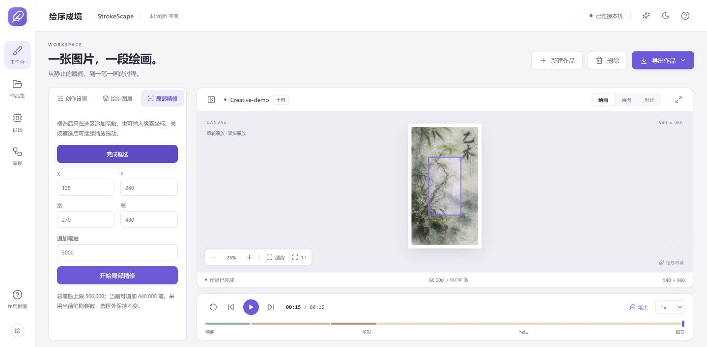

<div align="center">

# 绘序成境 · StrokeScape

**把静态图像，重构成可逐笔播放的绘画过程。**

本地运行 · 结构感知 · 8 种笔刷 · 最高 500,000 笔 · 局部精修

[Windows 下载](https://github.com/Linference/StrokeScape/releases/tag/v0.1.0) · [观看演示](https://github.com/Linference/StrokeScape/raw/refs/heads/main/docs/media/drawing-demo.mp4) · [源码启动](#快速开始) · [技术架构](#系统架构) · [使用文档](#文档导航)

</div>

StrokeScape 是一套基于**计算机视觉与非真实感渲染（NPR）**的数字绘画工作台。导入照片或插画后，系统分析图像结构与颜色，通过多层笔触和局部残差反馈，生成带有独立路径、笔形、颜色和时间属性的绘画过程。

你可以逐笔播放、放大检查、滑动对比原图，框选区域追加细节，再导出 **HTML、MP4 或可继续编辑的 `.strokescape` 工程**。普通 CPU 即可完成完整流程；可选 CUDA 只加速密集图像结构分析。当前实现不依赖文生图模型或云端生图 API。

> **版本说明：**下面展示的是 `main` 分支源码版。现有 **v0.1.0 Windows 下载包**早于本次更新，尚未包含 8 种笔刷、局部精修、回收站等最新功能。体验完整功能请从源码启动；更新源码不会自动更新下载包。

## 先看效果



实际运行截图：用户提供的“乙木·春生万物”展示图，干刷、60,000 笔、540 × 960 画布、15 秒动画设置；左侧框选工具与画布并排，支持另存精修作品。

### 从空白画布到完整作品

[](https://github.com/Linference/StrokeScape/raw/refs/heads/main/docs/media/drawing-demo.mp4)

点击动图观看或下载 MP4。视频是另一份圆笔示例：150,000 笔、941 × 1672 画布、约 30 秒动画。**动画时长不等于笔触生成耗时。**

<details>
<summary>展开查看原图与笔触重构结果</summary>

| 输入图像 | 实际导出视频末帧 |
| :---: | :---: |
|  |  |

</details>

素材由用户指定用于本仓库演示，来源与参数见[展示素材说明](docs/media/README.md)。

## 能做什么

| 创作环节 | 当前能力 |
| --- | --- |
| 图像变为绘画过程 | 四层递进重构：铺底 → 塑形 → 勾线 → 细节；每笔独立记录与严格串行播放 |
| 调整笔触风格 | 圆笔、石墨铅笔、马克笔、干刷、水彩、油画、点彩、彩色铅笔；可调粗细、着色、纹理与留白 |
| 检查还原效果 | 滚轮 / 双指缩放、拖动、原始像素 1:1、原图与当前绘画进度滑动对比 |
| 改善局部细节 | 框选或输入像素坐标，追加 200–100,000 笔并另存新作品，最终画面选区外保持不变 |
| 控制生成预算 | 自定义 200–500,000 笔；可选细节误差趋缓自动停止、邻近区域与颜色衔接 |
| 观察生成过程 | 后台逐步发布实际反馈画布缩略图，显示进度、误差趋势与近似质量指标 |
| 保存与管理 | 作品重命名、标签搜索 / 筛选、回收站恢复、工程导入 / 导出 |
| 分享与展示 | 单文件离线 HTML、实时画布录制 MP4、固定采样的逐帧视频导出 |

适合制作插画与照片的绘画式展示、短视频视觉素材、数字展览内容，以及观察笔触、色块和层次关系。它重构的是算法绘画过程，不推断原作者的真实作画步骤，也不识别汉字的标准书写笔顺。

## 工作流程


[流程图源文件](docs/diagrams/workflow.workflow.json) · [高清 PNG](docs/diagrams/workflow.png) · [下载可切换主题与导出的交互 HTML](https://github.com/Linference/StrokeScape/raw/refs/heads/main/docs/diagrams/workflow.html)

1. **读取与规范化。** Pillow 处理 EXIF 方向、透明背景与尺寸，统一为本地输入图像。
2. **提取结构。** Sobel 梯度和高斯平滑结构张量估计边缘、切线方向与方向一致性。
3. **分层生成笔触。** 从宽笔铺底到细笔细化，依据残差和边缘重要性选择候选位置，沿局部结构延伸路径。
4. **反馈与停止。** 每笔只更新影响区域的误差；可选的自适应策略在细节层检查改善趋势。
5. **编排与渲染。** 按路径长度与图层权重分配串行时间，交给共享 Canvas 引擎逐笔绘制。
6. **保存与交付。** 元数据保存在 SQLite，作品文件保存在本机；输出 HTML、视频或可移植工程。

**局部精修**从原作品快照继续，保留旧笔触的形态、颜色、种子与纹理，新笔触携带选区裁剪；整体时间轴会按设定动画时长重新编排。

## 系统架构


[架构图源文件](docs/diagrams/architecture.architecture.json) · [高清 PNG](docs/diagrams/architecture.png) · [下载交互 HTML](https://github.com/Linference/StrokeScape/raw/refs/heads/main/docs/diagrams/architecture.html)

工作台通过本机 REST API 提交任务和轮询状态。笔触生成由**进程池**执行，视频导出由**线程池**调度；前端保持可操作。笔触数据、预览、导出文件与元数据分开存放，桌面窗口和浏览器使用同一套本地服务。

### 技术栈与模块分工

| 层级 | 技术 | 作用 | 代码入口 |
| --- | --- | --- | --- |
| 交互工作台 | React 19、TypeScript、Vite 6、Lucide | 创作设置、作品集、设备信息、操作反馈 | [`src/App.tsx`](src/App.tsx) |
| 画布检查 | React、CSS Transform、Pointer Events | 缩放、拖动、双指操作、对比线与精修框选 | [`src/CanvasViewport.tsx`](src/CanvasViewport.tsx) |
| 本地接口 | Python、FastAPI、Uvicorn、Pydantic | 输入校验、任务队列、取消、精修、工程与下载接口 | [`backend/api.py`](backend/api.py) |
| 图像与笔触算法 | OpenCV、NumPy、Pillow | 结构张量、方向场、分层采样、局部残差、时间编排 | [`backend/engine.py`](backend/engine.py) |
| 笔形与纹理 | Python + JavaScript 的确定性几何 | 八种笔刷、线束、点彩、透明叠色与断续留白 | [`backend/brushes.py`](backend/brushes.py) |
| 共享绘制引擎 | Canvas 2D、requestAnimationFrame | 应用、HTML、MP4 共用的增量渲染与检查点 | [`public/renderer.js`](public/renderer.js) |
| 可选 GPU | CuPy、CUDA、cupyx.scipy.ndimage | 仅加速密集图像特征分析，失败回退 CPU | [`backend/hardware.py`](backend/hardware.py)、[`engine.py`](backend/engine.py) |
| 视频输出 | Playwright、Chromium、captureStream、MediaRecorder、FFmpeg | 本地画布录制、流式写入、封装 / 转码；保留逐帧方式 | [`backend/recorder.py`](backend/recorder.py)、[`exporter.py`](backend/exporter.py) |
| 作品与工程 | SQLite、JSON、ZIP | 名称、标签、状态、回收站，以及 `.strokescape` 工程 | [`backend/storage.py`](backend/storage.py)、[`projects.py`](backend/projects.py) |
| 桌面与打包 | 可选 pywebview、PyInstaller | 本地窗口与 Windows 便携包；可内置 Chromium、FFmpeg | [`launch.py`](launch.py)、[`packaging/`](packaging/) |

## 核心算法如何工作

### 结构张量：决定笔触沿哪里走

亮度梯度刻画局部颜色变化，平滑后的结构张量概括邻域方向：

$$
J=G_\sigma * \begin{bmatrix} I_x^2 & I_xI_y \\ I_xI_y & I_y^2 \end{bmatrix},\qquad
\theta=\tfrac12\operatorname{atan2}(2J_{xy},J_{xx}-J_{yy})+\tfrac\pi2
$$

系统沿切线方向向两端延伸折线路径；方向一致性较弱时允许随机方向，避免把所有区域强行排成一致线条。当前算法没有单独的头发、五官、文字或物体语义识别模块。

### 局部残差：决定下一笔画哪里

每层使用不同模糊尺度的参考图。候选位置依据“参考图与当前画布的颜色差 + 边缘重要性”评分；开启自然顺序时，额外考虑与上一落笔位置的距离和颜色变化。

落笔后，算法**只更新这条笔触影响范围内的残差**，减少高笔数场景下的重复全图计算。候选选择是启发式采样，没有逐个模拟并比较全部候选笔触的真实收益，也不保证全局最优。

### 多层预算：先建立整体，再补充细节

铺底、塑形、勾线使用有限的粗层预算，额外笔数主要投入细节层；预算提高时，细节笔触逐渐缩短、变细。三档预设为：

| 预设 | 目标笔数 | 最长边上限 | 默认动画时长 |
| --- | ---: | ---: | ---: |
| 速写 | 18,000 | 960 px | 90 秒 |
| 标准 | 60,000 | 1440 px | 180 秒 |
| 精细 | 150,000 | 1920 px | 300 秒 |

自定义上限为 **500,000 笔**，画布最长边可设为 2560 px，动画时长可设为 15–600 秒；低分辨率原图不会放大。关闭自适应停止时按预算生成；开启后预算是上限，实际笔数可能更少。

### 严格时间轴与可复现笔形

相邻笔触满足：

$$ t_i+d_i\le t_{i+1} $$

时长由路径长度与图层重要性分配，并以累计整数刻度降低大量短笔触的舍入误差。图层之间有约 200 ms 间隔。程序化纹理由作品种子、笔触序号和参数确定，回退与重播不会重新随机化。

每笔的主要数据包括 `p` 路径、`c` 颜色、`w` 宽度、`o` 不透明度、`l` 图层、`s` 开始时间、`dt` 持续时间；可选的 `b / seed / tx / g / clip` 保留独立笔刷、种子、纹理、留白与裁剪信息。

## 视频为什么可以直接录制画布

默认路径为：**共享 Canvas 播放 → captureStream / MediaRecorder → 编码块写入本地 → FFmpeg 封装或转码**。支持浏览器 H.264 时直接整理为 MP4，否则尝试 WebM 后转码。它不录制桌面、其他窗口、鼠标或声音，无需屏幕共享权限。

录制耗时受动画时长、渲染压力、浏览器与编码方式影响，可能长于动画本身；目标帧率也不保证在高负载下全部达到。需要固定时间采样时可选择“逐帧导出”，通过累计画布与 PNG 帧管道交给 FFmpeg。

## CPU、CUDA 与编码加速分别负责什么

| 能力 | 当前范围 |
| --- | --- |
| CPU | 完整生成路径：特征分析、候选采样、笔触几何、残差更新与时间编排 |
| CuPy / CUDA（可选） | 密集图像结构分析；不等于全流程 GPU 生成 |
| 视频硬件编码 | 分别试运行可用的 NVENC、QSV、AMF 等编码器，取决于驱动、FFmpeg 构建及所选导出方式 |
| 自动与回退 | 小图优先 CPU 的启发式选择；CUDA 特征计算失败重新执行 CPU 分析，手动不可用 GPU 模式返回原因 |

便携版 v0.1.0 不包含 CuPy。源码版需自行安装与 CUDA 环境匹配的 CuPy 包。显卡识别成功、CUDA 自检成功与视频编码器可用是三项独立结果；当前没有通用整体提速承诺，也不保证 CPU 与 CUDA 特征结果逐像素一致。

## 一组可复现的预算实验

同一张展示图、288 × 512、CPU、圆笔、种子 42、自然顺序开启、自适应停止关闭，本机单次测量：

| 笔触数量 | 生成耗时 | 近似 MAE ↓ | 近似 PSNR ↑ |
| ---: | ---: | ---: | ---: |
| 20,000 | 2.21 秒 | 17.7691 | 19.6413 dB |
| 60,000 | 10.28 秒 | 15.1561 | 20.7680 dB |
| 150,000 | 22.64 秒 | 14.2633 | 20.8929 dB |
| 500,000 | 63.93 秒 | 13.4744 | 21.0028 dB |

本例中增加笔数降低了误差，但改善逐渐减小。指标来自 **OpenCV 近似反馈画布**，与最终 Canvas 的线帽、透明度和抗锯齿有差异；不是审美评分，也不证明多图像或跨设备性能。耗时包括预览回调开销，未进行重复统计。

[查看 CSV](docs/experiments/budget-results.csv) · [参数与原图摘要](docs/experiments/budget-experiment.json) · [实验说明](docs/creative-tools.md#同图不同预算实验)

```powershell
.venv/Scripts/python.exe -m scripts.compare_budgets docs/media/sample-source.png --edge 512
```

## 快速开始

### Windows 便携版

前往 [v0.1.0 下载页](https://github.com/Linference/StrokeScape/releases/tag/v0.1.0)，下载 `StrokeScape-0.1.0-Windows-x64.zip`，**完整解压**到可写目录后双击 `StrokeScape.exe`。无需安装 Python、Node.js 或 FFmpeg；保留 `_internal` 文件夹。

适用于 Windows 10 / 11 x64。当前为未签名的早期测试包，可核对下载页的 `SHA256SUMS.txt`。包内使用 WebView2 或内置 Chromium，作品保存在 EXE 同目录的 `UserData/`。该包尚未包含当前源码全部新功能。

### 最新源码版

开发环境：**Python 3.11+、Node.js 20.19+、FFmpeg**。首次安装依赖需要联网；准备完成后，日常图片处理不依赖云端服务。

```powershell
git clone https://github.com/Linference/StrokeScape.git
cd StrokeScape
python -m venv .venv
.venv\Scripts\python -m pip install -r requirements.txt
npm ci
npm run build
.venv\Scripts\python launch.py
```

打开 **http://127.0.0.1:8765/**，或在准备完依赖后双击 `启动绘序成境.cmd`。

<details>
<summary>桌面窗口、开发模式与浏览器配置</summary>

桌面窗口（Windows 的 pywebview 需要可用 WebView2）：

```powershell
.venv\Scripts\python launch.py --desktop
```

若视频导出找不到可用浏览器，可安装 Edge / Chrome，或安装 Playwright Chromium：

```powershell
.venv\Scripts\python -m playwright install chromium
```

前后端开发模式在两个终端分别启动：

```powershell
.venv\Scripts\python -m uvicorn backend.api:app --host 127.0.0.1 --port 8765
npm run dev
```

服务只监听回环地址。`launch.py --port 其他端口` 可更换端口。

</details>

## 项目结构

```text
StrokeScape/
├─ src/                     React 工作台、笔刷选择、画布检查、作品集
├─ public/renderer.js       应用 / HTML / 视频共享的 Canvas 笔触渲染器
├─ public/recording.js      画布录制控制与编码块发送
├─ backend/
│  ├─ api.py                本地 API、任务调度、精修与导出
│  ├─ engine.py             结构分析、残差采样、分层笔触、时间轴
│  ├─ brushes.py            八种程序化笔刷的确定性几何
│  ├─ hardware.py           显卡、CUDA 与 FFmpeg 编码器检测
│  ├─ recorder.py           实时画布录制与本地编码块接收
│  ├─ exporter.py           单文件 HTML 与视频输出
│  ├─ storage.py            SQLite 元数据与回收站
│  └─ projects.py           工程校验、ZIP 导入与下载缓存
├─ docs/                    使用说明、流程 / 架构图、演示与实验记录
├─ scripts/                 性能对比、录制与便携版验证
├─ tests/                   算法、接口、工程与跨语言渲染测试
├─ packaging/               Windows 打包与第三方运行时说明
└─ launch.py                浏览器 / 可选桌面窗口启动入口
```

## 数据与验证

源码版默认保存到 `data/`，便携版默认保存到 `UserData/`。SQLite 存放元数据；每件作品按内部编号保存原图副本、笔触与导出文件。原图与历史任务不随源码或公开下载包分发。

| 配置 | 用途 |
| --- | --- |
| `HUIXU_DATA` | 自定义作品数据目录 |
| `HUIXU_FFMPEG` | 指定 FFmpeg 可执行文件 |
| `HUIXU_BROWSER` | 指定 Chromium 系浏览器可执行文件 |

```powershell
.venv\Scripts\python -m pytest -q
npm run build
```

当前功能提交通过 **61 项测试**，覆盖预算、确定性、严格串行、取消、回退、八种笔刷的 Python / JavaScript 几何一致性、精修裁剪、回收站、历史库迁移、工程往返及 Windows 文件占用下载。真实精修作品也已导出 HTML、工程和 H.264 MP4。

进一步验证：

- [`scripts/verify_recording.py`](scripts/verify_recording.py)：录制与逐帧导出、视频首尾帧与取消。
- [`scripts/benchmark_backends.py`](scripts/benchmark_backends.py)：同图同预算 CPU / CUDA 重复测量。
- [`scripts/verify_portable.py`](scripts/verify_portable.py)：解压后的 EXE 在无开发环境 PATH 下完成生成与导出。

程序化笔刷不包含真实颜料扩散或纸张纤维仿真。当前顺序策略和自适应停止属于启发式方法；多图像基线、消融实验、最终 Canvas 图像质量评估和观看体验研究仍待开展。

## 文档导航

| 文档 | 内容 |
| --- | --- |
| [创作工具](docs/creative-tools.md) | 精修、笔刷参数、生成策略、过程预览与工程 |
| [笔刷与画布](docs/brushes-and-inspection.md) | 八种风格、缩放、原图对比与渲染边界 |
| [回收站](docs/deleting-works.md) | 恢复、彻底删除与文件清理范围 |
| [图表源文件](docs/diagrams/README.md) | 流程图、架构图与可编辑 JSON / HTML |
| [Windows 打包](packaging/README.md) | 桌面分发、运行时与便携版构建 |
| [第三方组件](THIRD_PARTY_NOTICES.md) | 依赖许可证与对应源码说明 |

项目自身源码尚未选定许可证。展示图片不另行授予素材许可；软件内置“山间来信”为代码生成的原创测试插画。
