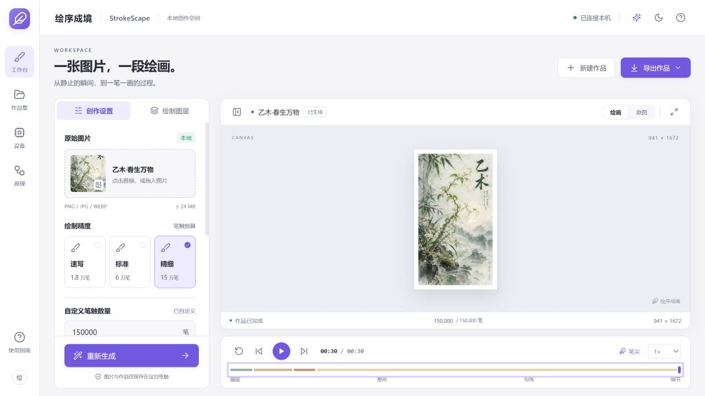

# 绘序成境 · StrokeScape

让静态图片一笔一画，渐成其境。上传图片，系统分析颜色、轮廓与结构，生成从铺底、塑形到勾线、细节的绘画动画，支持交互预览及 HTML / MP4 导出。日常创作在本机完成，无需云端服务。

[下载 Windows 便携版](https://github.com/Linference/StrokeScape/releases/tag/v0.1.0) · [观看绘画演示 MP4](https://github.com/Linference/StrokeScape/raw/refs/heads/main/docs/media/drawing-demo.mp4) · [开发者启动](#启动)

## 看看效果

### 工作台



上图为当前源码版界面：支持直接输入自定义笔触数量、恢复预设，以及逐笔播放、回退和时间轴跳转。展示图为用户提供的“乙木·春生万物”，使用精细模式、150,000 笔、30 秒动画时长。

### 从空白画布到完整作品

[](https://github.com/Linference/StrokeScape/raw/refs/heads/main/docs/media/drawing-demo.mp4)

点击动图可打开或下载 **MP4 演示视频**。此示例由软件实际导出，使用 150,000 笔、941 × 1672 画布，动画约 30 秒；动图为视频的缩小预览，不是生成耗时展示。

### 原图与笔触重构

| 原始示例图 | 笔触重构结果 |
| :---: | :---: |
|  |  |

展示使用用户指定的图片，素材来源与参数见[素材说明](docs/media/README.md)。当前下载包仍为 v0.1.0，尚未包含源码版最新界面与实时录制更新。

## 直接使用（Windows）

前往 [v0.1.0 下载页](https://github.com/Linference/StrokeScape/releases/tag/v0.1.0)，下载 **StrokeScape-0.1.0-Windows-x64.zip**。

1. 将 ZIP **完整解压**到可写文件夹。
2. 双击 **StrokeScape.exe**。
3. 导入图片或尝试内置原创示例，选择精度并开始创作。

适用于 Windows 10 / 11 x64。无需安装 Python、Node.js 或 FFmpeg；请保留 `_internal` 文件夹。包内提供 Chromium，WebView2 不可用时可自动使用内置浏览器窗口。当前为未签名的早期测试版，可用下载页的 `SHA256SUMS.txt` 核对文件。

便携版提供完整 CPU 生成与可用的视频硬件编码检测，**不包含 CuPy/CUDA 图像计算组件**。GPU 图像分析需使用源码版配置。作品保存在 EXE 同目录的 `UserData/`，发布包不包含开发者原图与历史记录。

## 启动

以下适用于开发者。开发环境需要 Python 3.11+、Node.js 20.19+ 和 FFmpeg。首次准备依赖需要联网；准备完成后，日常使用无需联网。

```powershell
python -m venv .venv
.venv\Scripts\python -m pip install -r requirements.txt
npm ci
npm run build
.venv\Scripts\python launch.py
```

也可以双击 `启动绘序成境.cmd`。它会优先使用项目 `.venv`，没有虚拟环境时使用系统 Python。

桌面窗口模式：

```powershell
.venv\Scripts\python launch.py --desktop
```

Windows 的 pywebview 窗口需要可用的 WebView2 运行时。便携版另外包含 Chromium 和 FFmpeg，构建方法见 [打包说明](packaging/README.md)。

若 MP4 导出未找到浏览器，可安装 Edge/Chrome，或首次执行：

```powershell
.venv\Scripts\python -m playwright install chromium
```

服务只监听 `127.0.0.1:8765`。可通过 `--port 其他端口` 更改端口。开发模式在两个终端分别启动：

```powershell
python -m uvicorn backend.api:app --host 127.0.0.1 --port 8765
npm run dev
```

## 已实现

当前预设为速写 18,000 笔 / 最长边 960，标准 60,000 笔 / 1440，精细 150,000 笔 / 1920。精度预设下方直接提供“自定义笔触数量”，支持 200–200,000 之间的任意整数，留空跟随预设，也可一键恢复；超出范围时阻止生成。“画布设置”支持最高 2560 像素最长边，不会放大低分辨率原图。预设动画时长为 90 / 180 / 300 秒，可调整到 15–600 秒。

高笔数模式将更多预算分配给细节层，并逐渐缩小细节笔宽和路径长度。每笔结束后仅更新其影响区域的残差，避免反复扫描整幅图像。时间轴使用累计整数刻度，画布检查点内存限制为 32 MiB。

- 图片上传/拖拽、透明图合成、EXIF 方向处理、尺寸自适应。
- 三档笔触预算、动画总时长、自动/CPU/GPU 设置。
- 结构张量方向引导、四层笔触生成、局部残差引导采样。
- 确定性随机种子、每笔路径与颜色、严格串行时间轴、图层间隔。
- Canvas 增量播放、有限数量画布检查点、拖动进度、逐笔前后跳转、图层跳转、速度调整。
- SQLite 历史任务、后台进程生成、任务取消、失败反馈、重新生成。
- 无外部资源的单文件 HTML 导出。
- 共用 Canvas 渲染代码的实时画布录制与逐帧 MP4 导出，支持进度、取消及编码器回退。
- 真实显示设备识别、CUDA 自检、FFmpeg 实际试编码。

## GPU 能力的边界

显卡信息、CUDA 图像计算和硬件视频编码分别检测。检测到 NVIDIA 显卡不代表已配置 CUDA 计算环境。

- CPU 是完整基础后端。
- 可选 CuPy CUDA 后端目前只加速密集图像结构分析；笔触选择、局部残差更新和时序编排在 CPU 执行。
- 需自行安装与设备、驱动、CUDA 运行环境兼容的 CuPy 包。没有 CuPy 时自动使用 CPU；手动 GPU 模式在不可用时返回明确原因。
- 自动模式的小图阈值属于初步启发式规则，尚未经系统性能实验校准。
- GPU 目前只加速结构分析，不承诺整体提速。`scripts/benchmark_backends.py` 在同一图片、预算、分辨率和种子下交替重复 CPU/GPU 核心生成；结果保存在 `artifacts/backend-benchmark-*.json`。首次 GPU 运行含部分模块/内核初始化开销，结果不能外推到所有图像和设备。
- GPU 特征分析失败时重新执行 CPU 分析；当前尚未实现 GPU 分批自适应显存管理。
- 分别试运行 NVENC、QSV、AMF 与软件编码器。实际可用取决于 FFmpeg 构建、驱动和硬件；便携版使用 LGPL FFmpeg，并提供 OpenH264 / MPEG-4 等回退路径。
- GPU 与 CPU 使用不同底层算子，不承诺逐像素一致。任务保存实际后端与种子。

## 渲染与研究边界

`public/renderer.js` 是预览、HTML 与视频输出共用的绘制实现。默认的实时录制使用 Canvas captureStream 与 MediaRecorder，播放绘画时直接录制画布，编码块分段写入本机文件，不进行逐帧截图或整段视频内存缓存。支持 H.264 时由浏览器直接编码，FFmpeg 仅整理 MP4 容器；其他情况下尝试 WebM 录制后转码。录制不捕获桌面、鼠标、声音或其他窗口，无需屏幕共享权限。

实时录制耗时约等于动画时长加启动与封装时间，所选帧率是采集目标，负载较高时可能掉帧。若需要固定时间采样，可选择保留的“逐帧导出”：累计更新画布，通过 PNG 帧管道交给 FFmpeg。两种方式的画面采样和压缩结果不保证逐像素一致。

算法用于残差反馈的内部画布由 OpenCV 近似栅格化，它与 Canvas 的线帽和抗锯齿不完全相同。正式质量评估应使用最终 Canvas 输出。候选笔触目前通过残差引导采样，并未逐一计算所有候选笔触的真实增益；尚未实现全局笔触顺序联合优化。不能据此宣称算法优于论文或现有软件。

内置“山间来信”是代码生成的原创测试插画，无需下载第三方图片。项目未实现机器学习模型训练或生成式 AI。

## 数据与配置

源码版默认存放于 `data/`，便携版默认存放于 EXE 同目录的 `UserData/`：SQLite 元数据、规范化原图、笔触 JSON、导出 HTML/MP4。可用 `HUIXU_DATA` 指向其他目录，`HUIXU_FFMPEG` 指定 FFmpeg 可执行文件，`HUIXU_BROWSER` 指定浏览器可执行文件。

文件格式中的笔触字段：`p` 为折线路径坐标、`c` 为颜色、`w` 为宽度、`o` 为不透明度、`l` 为图层、`s` 为开始毫秒、`dt` 为持续毫秒。

## 验证

```powershell
python -m pytest -q
npm run build
```

测试覆盖预算、确定性、严格串行、基本误差下降、取消、CPU 回退、独立 HTML 转义、输入校验。浏览器集成测试与视频验证脚本位于 `scripts/`。完整多图像基线对比、SSIM/PSNR 报告和用户研究尚待开展。

`python scripts/verify_recording.py --compare` 在同一作品上比较录制与逐帧导出，检查视频时长、解码后首尾帧和录制取消。该脚本在独立测试目录运行，不使用私人作品。

发布包还需运行 `python scripts/verify_portable.py release/StrokeScape-0.1.0-Windows-x64.zip`，验证解压后的 EXE 在无开发环境 PATH 的条件下完成笔触生成、HTML 及真实 MP4 导出。

## 第三方组件

许可证与对应源码说明见 [THIRD_PARTY_NOTICES.md](THIRD_PARTY_NOTICES.md)。当前尚未为项目自身源码选定许可证。
